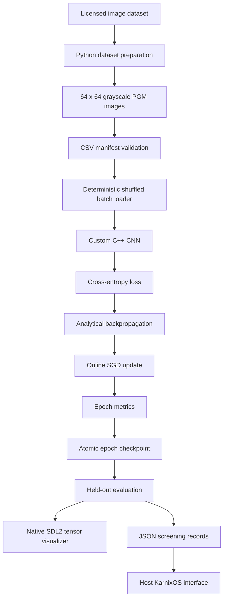

# Karnix Spine Edge

Karnix Spine Edge is a C++14 research and demonstration project for training small convolutional neural networks on musculoskeletal radiographs and lumbar MRI images. It includes dataset preparation, training, evaluation, atomic checkpoints, terminal telemetry, native SDL2 visualization, JSON result storage, and integration with the host-side KarnixOS interface.

This project is not a medical device and is not suitable for clinical diagnosis. Current held-out accuracy is low and all findings must be treated as experimental.

The active OA checkpoint is selected by held-out evaluation rather than by forcing
probabilities upward. The promoted `models/osteoarthritis_cnn.weights` checkpoint
was trained for 12 epochs at learning rate `0.0005` and measured 59.17% accuracy,
75.00% sensitivity, and 43.33% specificity on the 120-image held-out OA test set.
This model must not be presented as an 80-90% accurate clinical model.

## Current Status

The repository currently supports these tasks:

| Modality | Task | Dataset status | Model status |
|---|---|---|---|
| Knee radiograph | No OA vs osteoarthritis | Automatically downloaded and prepared | Implemented and trained |
| Lumbar MRI | No stenosis vs stenosis pathology | Automatically downloaded and prepared | Implemented and trained |
| DEXA/DXA | Normal BMD vs osteoporosis | Import pipeline implemented; no open labeled scan archive bundled | Not trained by default |
| Vertebral measurements | Normal, disk hernia, spondylolisthesis | Small UCI sample CSV included | Rule-based classifier |
| Brain MRI | Glioma, meningioma, pituitary tumor, no tumor | 1,000-image balanced subset prepared | Four-class training target pending |

The project deliberately does not treat ordinary osteoporosis X-rays as DEXA scans. A genuine labeled DEXA image source is required before the DEXA CNN path can train.

### Brain Tumor MRI

The repository includes a reproducible 1,000-image subset at `data/brain_tumor`, prepared from the public [Brain Tumor Classification MRI source repository](https://github.com/sartajbhuvaji/brain-tumor-classification-dataset) at commit `3ea9f4eae54c67e5bddbf6f7a73582967a5f5f79`.

The subset contains four balanced classes:

- `glioma_tumor`
- `meningioma_tumor`
- `pituitary_tumor`
- `no_tumor`

There are 200 training images and 50 testing images per class. `manifest.csv` records the split, class, source path, and SHA-256 hash; `DATASET_METADATA.json` records provenance and the license note. Recreate it with:

```bash
python3 prepare_brain_tumor_dataset.py
```

The current `SpineCNN` CLI is a binary classifier, so this dataset is prepared for a separate four-class brain-tumor model; it must not be passed to the existing two-class OA/MRI training command without a multiclass model change.

## Architecture



### CNN Structure

The same binary CNN architecture is trained separately for OA and MRI:

```text
Input: 1 x 64 x 64
  -> Conv2D: 1 to 4 channels, 3 x 3
  -> ReLU
  -> MaxPool: 2 x 2
  -> Conv2D: 4 to 8 channels, 3 x 3
  -> ReLU
  -> MaxPool: 2 x 2
  -> Conv2D: 8 to 16 channels, 3 x 3
  -> ReLU
  -> MaxPool: 2 x 2
  -> Flatten: 16 x 6 x 6 = 576 values
  -> Dense: 576 to 32
  -> ReLU
  -> Dense: 32 to 2
  -> Softmax
```

The model has 20,034 trainable parameters stored as double-precision values. OA, MRI, and optional DEXA use separate weight files.

## Training Lifecycle

The C++ training command implements the following stages:

1. **Dataset**: reads a CSV manifest, verifies every referenced image exists, and rejects manifests missing either binary class.
2. **Preprocessing**: loads the image, converts it to grayscale, resizes it to 64 x 64, and normalizes pixels from $[0,1]$ to approximately $[-1,1]$.
3. **Batch loader**: shuffles sample indices deterministically for each epoch and presents groups of 16 by default.
4. **Model**: performs three convolution, ReLU, and pooling blocks followed by two dense layers.
5. **Loss**: calculates cross-entropy from the predicted probability for the ground-truth class.
6. **Forward pass**: produces probabilities for the two task-specific classes.
7. **Backpropagation**: propagates analytical gradients through dense, pooling, activation, and convolution layers.
8. **Optimizer**: applies online stochastic gradient descent for each sample within the loaded batch. This is not vectorized mini-batch gradient accumulation.
9. **Epochs**: setup runs three complete dataset passes by default.
10. **Checkpoint**: saves weights atomically after every epoch and saves the final model separately.

Training stops with an error if the loss or model probabilities become NaN or infinite.

## Datasets

### Knee Osteoarthritis Radiographs

Source: [Knee Osteoarthritis Dataset with Severity Grading](https://www.kaggle.com/datasets/shashwatwork/knee-osteoarthritis-dataset-with-severity)

- License reported by Kaggle: CC BY 4.0
- Prepared subset: 600 radiographs
- Training: 480 images, balanced 240 No OA and 240 OA
- Testing: 120 images, balanced 60 No OA and 60 OA
- Negative class: Kellgren-Lawrence grade 0
- Positive class: Kellgren-Lawrence grades 2, 3, and 4
- Grade 1 is excluded because it represents doubtful OA
- Deterministic selection seed: `20260909`

The preparation record is generated at `data/osteoarthritis/SOURCE.txt`.

### Lumbar MRI

Source: [Diagnosis Lumbar Spinal Patients MRI Dataset](https://www.kaggle.com/datasets/abdullahkhan70/lumbar-spinal-mri-dataset)

- DOI: `10.34740/KAGGLE/DSV/14332076`
- License reported by Kaggle: CC0 Public Domain
- Source archive: 13,686 preprocessed 400 x 400 grayscale MRI images
- Prepared subset: 600 images
- Training: 480 images, balanced 240 No Stenosis and 240 pathology
- Testing: 120 images, balanced 60 No Stenosis and 60 pathology
- Negative class: No Stenosis
- Positive class: Herniated Disc or Thecal Sac Compression
- Deterministic selection seed: `20260909`

The binary merge is necessary because the current C++ CNN has two output classes. Original subtype names remain in the CSV manifests and `data/mri/SOURCE.txt`.

### DEXA/DXA

The code contains a DEXA preparation and training path, but no DEXA model is generated by default. Public searches performed during development found ordinary radiographs, tabular bone-density measurements, and restricted datasets, but not a verified open labeled archive of genuine DEXA scan images suitable for this pipeline.

The screening CLI now records an experimental DEXA trabecular bone score proxy from pixel-to-pixel texture variation. This is a microarchitecture signal estimate for imported scan images, not a replacement for calibrated manufacturer TBS software.

The importer requires genuine scan exports in this structure:

```text
dexa-source/
├── train/
│   ├── normal/
│   └── osteoporosis/
└── test/
    ├── normal/
    └── osteoporosis/
```

Source name, source URL, and license are mandatory. This prevents untraceable images from entering the training pipeline.

### CT and MRI Advanced Metrics

`spine_cli` accepts exported CT/MRI images through the normal screening path. Supported image extensions now include `jpg`, `jpeg`, `png`, `ppm`, `pgm`, `pbm`, `tiff`, `tif`, `bmp`, `dcm`, and `dicom`; non-PNM formats are converted through macOS `sips`.

Use `--modality CT`, `--modality MRI`, or `--modality DEXA` during screening:

```bash
./build/spine_cli --screen ./data/ct_exports --model ./models/osteoarthritis_cnn.weights --modality CT
./build/spine_cli --screen ./data/mri_exports --model ./models/lumbar_mri_cnn.weights --modality MRI --task LUMBAR_MRI --negative NO_STENOSIS --positive STENOSIS
./build/spine_cli --screen ./data/dexa_exports --model ./models/osteoarthritis_cnn.weights --modality DEXA
```

For CT, the CLI saves `cortical_thinning_index`, a 0-100 proxy for marrow cavity widening and cortical edge loss. For MRI, it saves `marrow_dark_ratio` and `marrow_signal`; bright marrow is treated as healthier fatty marrow signal, while a high dark-ratio is flagged for clinical review. These metrics are pixel-derived screening aids and must be confirmed by radiology review.

### UCI Vertebral Data and Clinical Rules

`data/uci_vertebral_samples.csv` contains a small sample of six biomechanical features:

- Pelvic incidence
- Pelvic tilt
- Lumbar lordosis angle
- Sacral slope
- Pelvic radius
- Grade of spondylolisthesis

`UCIVertebralAnalysis.hpp` uses manually encoded decision boundaries and weighted scoring. It does not train a random forest at runtime.

`ClinicalScoring.hpp` contains rule-based calculations inspired by Cobb angle, compression-fracture grading, bone-density thresholds, fracture risk, disc degeneration, and instability scoring. In the generic X-ray screening path, measurements are estimated from image intensity, variance, and edges. They are not obtained from segmentation or calibrated clinical measurements and must not be presented as validated medical measurements.

## Requirements

The automated setup currently targets macOS.

- macOS with `sips`
- CMake 3.10 or newer
- Apple Clang with C++14 support
- Python 3 with `venv`
- `curl`
- Homebrew
- SDL2 and SDL2_ttf for the native visualizer
- GCC and ncurses for the host KarnixOS application
- Approximately 1 GB of free disk space for downloaded archives, prepared data, models, and build files
- Internet access on the first run

`setup.sh` installs Pillow in `karnix_spine_edge/.venv`. On macOS it installs SDL2 and SDL2_ttf with Homebrew if they are absent.

## Quick Start

From the workspace root:

```bash
cd /Users/sudharsans/Documents/Karniiix/karnix_spine_edge
./setup.sh
```

The command performs the following work:

1. Checks dependencies.
2. Creates the Python virtual environment.
3. Downloads the OA and MRI archives when missing.
4. Prepares balanced 600-image subsets.
5. Builds `spine_cli` and `cnn_visualizer`.
6. Trains OA and MRI models with detailed terminal telemetry.
7. Tests every held-out image.
8. Verifies final epoch checkpoints.
9. Runs demonstration screening.
10. Builds the host KarnixOS executable.
11. Opens native OA and MRI visualization windows unless disabled.

Useful setup options:

```bash
./setup.sh --no-visualizer
./setup.sh --force-data
./setup.sh --launch-os

IMAGE_COUNT=600 MRI_IMAGE_COUNT=600 EPOCHS=3 MRI_EPOCHS=3 BATCH_SIZE=16 ./setup.sh
```

`--force-data` redownloads and regenerates prepared subsets. It increases setup time and network usage.

## Detailed Training Output

With `--verbose`, every training image reports:

```text
[TRAIN] epoch=1/3 batch=1/30 sample=1/480
        label=OA predicted=NO_OA
        p_negative=0.6132 p_positive=0.3868
        loss=0.9499 correct=no time_ms=3.12
        file=data/osteoarthritis/train/oa/...
```

Each batch reports mean loss, accuracy, size, and duration. Each epoch reports loss, accuracy, duration, and throughput. Testing reports every prediction followed by accuracy, sensitivity, specificity, confusion matrix, duration, throughput, and average milliseconds per image.

Generated logs:

```text
models/oa_training_full.log
models/oa_evaluation_full.log
models/oa_screening.txt
models/mri_training_full.log
models/mri_evaluation_full.log
models/mri_screening.txt
```

## Checkpoints and Recovery

Checkpoints are written through a temporary file and renamed only after the complete weight file has been written.

```text
models/checkpoints/oa/epoch_1.weights
models/checkpoints/oa/epoch_2.weights
models/checkpoints/oa/epoch_3.weights
models/checkpoints/mri/epoch_1.weights
models/checkpoints/mri/epoch_2.weights
models/checkpoints/mri/epoch_3.weights
```

Resume MRI training from a checkpoint:

```bash
./build/spine_cli \
  --train data/mri/train.csv 1 \
  --model models/lumbar_mri_cnn.weights \
  --task LUMBAR_MRI \
  --negative NO_STENOSIS \
  --positive STENOSIS \
  --batch-size 16 \
  --checkpoint-dir models/checkpoints/mri \
  --resume models/checkpoints/mri/epoch_3.weights \
  --verbose
```

SGD currently has no momentum or adaptive state, so resuming the weight checkpoint restores all optimizer-dependent state used by this implementation.

## Binary Weight Format and JARVIS Loading

`SpineCNN::save_weights()` and `SpineCNN::load_weights()` define a small native binary format. The first eight bytes are the ASCII marker:

```text
KSOA0001
```

Despite its name, this marker identifies serializer version 1, not the medical task. Both OA and MRI files use it because they share the same `SpineCNN` architecture. The file does not contain modality, class names, tensor dimensions, preprocessing metadata, accuracy, epoch number, or optimizer state.

Each trainable layer is then stored in this order:

```text
native size_t weight_count
weight_count native double values
native size_t bias_count
bias_count native double values
```

The five serialized layers and exact Apple Silicon layout are:

| Byte offset | Layer | Logical shape | Weights | Biases |
|---:|---|---|---:|---:|
| 0 | Magic `KSOA0001` | 8 bytes | - | - |
| 8 | Conv1 | `[4, 1, 3, 3]` | 36 | 4 |
| 344 | Conv2 | `[8, 4, 3, 3]` | 288 | 8 |
| 2728 | Conv3 | `[16, 8, 3, 3]` | 1,152 | 16 |
| 12088 | Dense1 | `[32, 576]` | 18,432 | 32 |
| 159816 | Dense2 | `[2, 32]` | 64 | 2 |

Total trainable values: 20,034 doubles. The file also contains ten 8-byte count fields and the 8-byte magic value:

$$
8 + (20{,}034 \times 8) + (10 \times 8) = 160{,}360\text{ bytes}
$$

ReLU, max-pooling, flatten, and Softmax contain no learned parameters and therefore write no blocks.

The current format uses native `size_t`, native `double`, and native byte order. The generated files were written on 64-bit little-endian Apple Silicon, where `size_t` and `double` are both eight bytes. This format is not guaranteed to be portable to a machine with a different ABI or byte order.

JARVIS must load a model as follows:

1. Select the model and class mapping externally:
  - `osteoarthritis_cnn.weights`: index 0 = No OA, index 1 = OA.
  - `lumbar_mri_cnn.weights`: index 0 = No Stenosis, index 1 = Stenosis.
2. Construct the exact `SpineCNN` architecture before reading parameters.
3. Read and compare all eight magic bytes with `KSOA0001`.
4. Read the five layer blocks in the exact order above.
5. Require each stored count to match the already-constructed tensor size.
6. Reject truncated files and files with trailing bytes.
7. Preprocess input as one grayscale 64 x 64 plane normalized with `(pixel - 0.5) / 0.5`.
8. Run `forward()` and interpret output indices using the external task mapping.

The hardened C++ loader performs steps 2 through 6. It does not infer the task from the filename or header.

The OA and MRI files have equal sizes because their architectures are identical. Their SHA-256 hashes and 18,844 of 20,034 parameter values differ, so they are not the same learned model. Both files were parsed to exactly byte 160,360 with zero trailing bytes.

## Manual Commands

Build both executables:

```bash
cmake -S . -B build
cmake --build build
```

Train OA:

```bash
mkdir -p models/checkpoints/oa
./build/spine_cli \
  --train data/osteoarthritis/train.csv 3 \
  --batch-size 16 \
  --checkpoint-dir models/checkpoints/oa \
  --verbose
```

Evaluate OA:

```bash
./build/spine_cli \
  --evaluate data/osteoarthritis/test.csv \
  --verbose
```

Train MRI:

```bash
mkdir -p models/checkpoints/mri
./build/spine_cli \
  --train data/mri/train.csv 3 \
  --model models/lumbar_mri_cnn.weights \
  --task LUMBAR_MRI \
  --negative NO_STENOSIS \
  --positive STENOSIS \
  --batch-size 16 \
  --checkpoint-dir models/checkpoints/mri \
  --verbose
```

Evaluate MRI:

```bash
./build/spine_cli \
  --evaluate data/mri/test.csv \
  --model models/lumbar_mri_cnn.weights \
  --task LUMBAR_MRI \
  --negative NO_STENOSIS \
  --positive STENOSIS \
  --verbose
```

## Native C++ Visualizer

`cnn_visualizer` is an SDL2 C++ application. It does not use a browser. It loads the trained model, performs a real traced forward pass, and displays:

- The actual prepared image
- A moving 3 x 3 convolution window
- Intermediate convolution tensors
- ReLU feature maps
- Max-pooling outputs
- Dense activations
- Softmax probabilities
- Ground truth and predicted class

Controls:

```text
Space        Play or pause
Left/Right   Move between network stages
Up/Down      Change animation speed
Esc          Close
```

Launch OA visualization:

```bash
./build/cnn_visualizer \
  data/osteoarthritis/screen \
  models/osteoarthritis_cnn.weights \
  OSTEOARTHRITIS NO_OA OA
```

Launch MRI visualization:

```bash
./build/cnn_visualizer \
  data/mri/screen \
  models/lumbar_mri_cnn.weights \
  LUMBAR_MRI NO_STENOSIS STENOSIS
```

## DEXA Training

After obtaining a licensed, labeled, genuine DEXA image dataset:

```bash
DEXA_SOURCE=/absolute/path/to/dexa-source \
DEXA_SOURCE_NAME="Dataset name" \
DEXA_SOURCE_URL="https://dataset-source" \
DEXA_LICENSE="License name" \
DEXA_IMAGE_COUNT=600 \
./setup.sh
```

This produces:

```text
data/dexa/train.csv
data/dexa/test.csv
data/dexa/SOURCE.txt
models/dexa_cnn.weights
models/checkpoints/dexa/
models/dexa_training_full.log
models/dexa_evaluation_full.log
```

The setup stops if either class is missing, there are too few images, source metadata is absent, an image cannot be opened, or model output becomes non-finite.

## Measured Results

The following values were measured on the current Apple M1 development machine using 600 prepared images per task, three epochs, and batch-loader size 16. Timing changes with hardware and whether data is already downloaded.

| Task | Final training accuracy | Test accuracy | Sensitivity | Specificity | Training time | Test time |
|---|---:|---:|---:|---:|---:|---:|
| Knee OA | 69.17% | 57.50% | 56.67% | 58.33% | 15.23 s | 0.42 s |
| Lumbar MRI stenosis | 74.79% | 45.00% | 36.67% | 53.33% | 16.53 s | 0.39 s |

The most recent complete cached-data setup took approximately 40 seconds. A first run takes longer because it downloads approximately 205 MB of OA data and 351 MB of MRI data.

These results are weak. The project demonstrates the complete ML engineering flow, but the models are not accurate enough for diagnosis or deployment.

## KarnixOS Integration

There are two different OS surfaces in this repository.

### Host KarnixOS

`os/main.c` builds a normal macOS terminal application using ncurses:

```bash
cd /Users/sudharsans/Documents/Karniiix
make -f os/Makefile
./KarnixOS
```

It reads:

```text
karnix_spine_edge/data/spine_records.json
karnix_spine_edge/data/uci_vertebral_samples.csv
```

Available shell commands include `help`, `train`, `scan`, `dir`, `uci`, `clear`, `up`, `down`, and `quit`. The `train` and `scan` commands launch the host C++ Spine Edge executable. The current OS command integration targets the OA workflow; MRI is launched directly through `spine_cli` or `cnn_visualizer`.

### Bare-Metal Karnix Kernel

`os/karnix_kernel/` is a separate freestanding x86 kernel intended for QEMU. It cannot execute the macOS C++ binary, use SDL2, download datasets, or train the CNN because it has no hosted C++ runtime, process loader, or normal filesystem.

Its medical records are compiled into `db_data.h`. `db_exporter.js` can generate that header from PostgreSQL or fallback records. This is display/export integration, not runtime ML execution inside the kernel.

## Project Layout

```text
karnix_spine_edge/
├── CMakeLists.txt
├── setup.sh
├── spine_cli.c++
├── cnn_visualizer.c++
├── prepare_oa_dataset.py
├── prepare_mri_dataset.py
├── prepare_dexa_dataset.py
├── medical/
│   ├── SpineCNN.hpp
│   ├── SpineEvaluationUtils.hpp
│   ├── UCIVertebralAnalysis.hpp
│   ├── ClinicalScoring.hpp
│   └── OnnxInference.hpp
├── data/
│   ├── cache/
│   ├── osteoarthritis/
│   ├── mri/
│   ├── images/
│   ├── uci_vertebral_samples.csv
│   └── spine_records.json
├── models/
│   ├── osteoarthritis_cnn.weights
│   ├── lumbar_mri_cnn.weights
│   ├── checkpoints/
│   └── training and evaluation logs
└── build/
    ├── spine_cli
    └── cnn_visualizer
```

Downloaded datasets, prepared images, generated models, logs, virtual environments, and build outputs are excluded from Git where configured because they can be regenerated by setup.

## Legacy Components

`OnnxInference.hpp` and model setup notes remain in the repository from an earlier ResNet/ONNX design. The active OA and MRI training paths described in this README use the custom `SpineCNN` weights, not a ResNet50 ONNX file. The ONNX implementation contains a simulation fallback and should not be presented as active production inference.

An earlier version trained or loaded `models/spine_model.weights` while the main screening loop obtained predictions from `OnnxInferenceEngine`. In that version, the locally trained `SpineCNN` was not clearly connected to the final prediction path. That limitation has been removed from the current implementation:

- OA screening loads `models/osteoarthritis_cnn.weights` into `SpineCNN` and calls `SpineCNN::preprocess()` followed by `SpineCNN::forward()`.
- MRI evaluation and visualization load `models/lumbar_mri_cnn.weights` into the same custom architecture using MRI-specific class labels.
- `models/spine_model.weights` is a legacy artifact and is not the active OA or MRI model.
- `OnnxInferenceEngine` is not used by the active OA or MRI prediction path.

### MURA/ResNet50 Training Time

No defensible MURA training duration is available from this repository. The repository does not contain:

- A complete MURA training script
- MURA training logs
- A recorded epoch count
- A recorded batch size
- Training hardware details
- Start/end timestamps or total training duration
- A trained `resnet50_mura.onnx` artifact produced by this project

The MURA references and `models/README.txt` describe how a ResNet50 model could be obtained, trained externally, and exported to ONNX. `OnnxInference.hpp` contains an incomplete ONNX integration and a feature-based simulation fallback. Neither is evidence that MURA training occurred in this repository.

Therefore, the project must report the MURA/ResNet50 training time as **unknown**. The measured training times elsewhere in this README apply only to the custom 20,034-parameter `SpineCNN` trained on the prepared OA and lumbar MRI subsets.

Voice scripts also predate the current multimodal command-line interface. They may still launch the default screening flow, but they are not the primary setup or training path documented here.

## Known Limitations

- Test accuracy is currently close to chance for both tasks.
- The CNN is small and trained for only three epochs by default.
- The batch loader groups and shuffles samples, but SGD updates occur per sample rather than from accumulated batch gradients.
- There is no augmentation, dropout, weight decay, learning-rate scheduler, early stopping, or patient-level cross-validation.
- The curated archive does not expose patient identifiers in the prepared manifest, so patient-level leakage cannot be ruled out.
- MRI uses a binary merge instead of preserving all three source classes.
- DEXA requires a separately licensed genuine scan-image dataset.
- The generic X-ray clinical scores are heuristic estimates, not calibrated measurements.
- `spine_records.json` grows on repeated screening runs unless it is cleared manually.
- The native visualizer is currently configured for macOS/Homebrew SDL paths.
- No component has regulatory approval.

## Appropriate Demo Claims

It is accurate to say that the project:

- Implements convolution, pooling, activation, dense layers, backpropagation, and SGD in C++.
- Downloads and prepares licensed OA and MRI datasets.
- Trains separate binary models for radiographs and MRI.
- Logs every training and test sample.
- Uses deterministic epoch shuffling and atomic checkpoints.
- Can resume training from a saved checkpoint.
- Visualizes real intermediate tensors in a native C++ window.
- Exports results for a host-side OS interface.

It is not accurate to claim radiologist-level performance, clinical-grade diagnosis, 100% detection, validated treatment recommendations, or a trained DEXA model.

## Medical Disclaimer

Karnix Spine Edge is an educational and research prototype. It must not be used to diagnose, exclude, monitor, or recommend treatment for any medical condition. Predictions and derived scores require independent review by qualified healthcare professionals using validated clinical systems.
